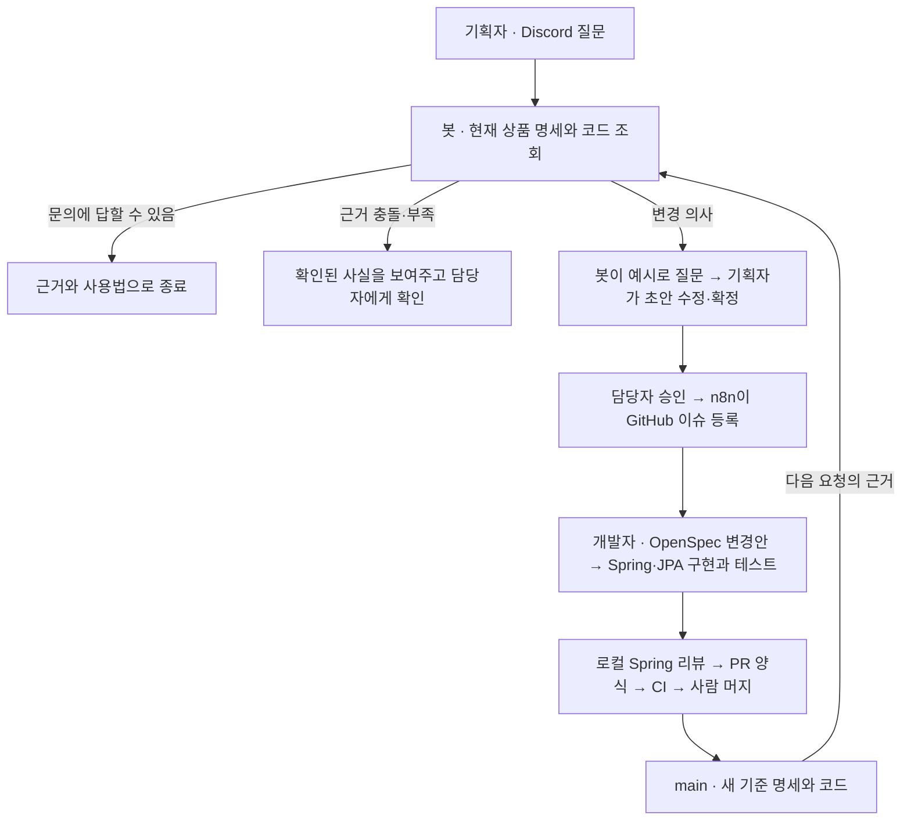

# 팀 요청이 다음 제품 답변으로 이어지는 설계

## Context

**설계안 · 구현 전.** 기획자가 “노트를 검색하면 노트북도 나와요?”라고 물으면 현재 답은 “이름 전체가 같아야 해요”다. 기획자가 부분 일치를 요청하고 팀이 구현하면, 다음 질문에는 새 답이 나와야 한다. 예시의 부분 일치는 가상의 제품 변경이다.

기존 배치는 Python 서비스가 Discord 이벤트와 대화를 처리하고 n8n이 검토·게시를 맡는다. 전환 대상은 [접수 운영 가이드](../../../../workflows/n8n/README.md)에서 관리한다.

## Goals / Non-Goals

기획자는 Discord에서 기대 결과를 승인하고, 개발자는 기술 설계와 검증을 맡는다. 지원 여부는 설정된 기준 브랜치에서 확인한다. 운영 서버 배포 상태 확인, 상품 검색 자체의 변경과 명세 파일의 실제 분할은 별도 작업이다.

## 역할과 실행 시점

| 단계 | 담당자와 판단 | 하네스 동작 |
|---|---|---|
| 문의·논의 | 기획자는 자연어로 질문하거나 답에 대한 의견을 남긴다. | 스레드에서 공식 `openspec-explore` 지침을 사용하는 읽기 전용 에이전트에 제품 근거 조회 도구를 제공한다. 같은 사실의 후속 대화는 확인한 근거를 재사용한다. |
| 제품 결정 | 변경을 원하면 기획자가 기존 동작을 바꿀지, 어떤 결과면 성공인지 결정한다. | 첫 변경 의사부터 `discord-issue-refinement` 지침을 함께 제공한다. OpenSpec 1.14.3의 proposal에서 이유·범위·영향을, specs에서 관찰 가능한 동작·예시를 가져온다. ‘노트북’만으로 해석이 갈리면 ‘스프링 노트’의 포함 여부를 묻는다. |
| 이슈 인계 | 담당자가 실제 게시할 전문을 보고 승인한다. | 사용자 결과가 달라지는 미결 질문이 있으면 답을 기다린다. 스레드의 합의와 근거로 기존 팀 양식을 채우고, 승인 버튼과 n8n이 해당 판본을 한 번 게시한다. |
| 개발 | 개발자가 승인 이슈로 공식 propose를 시작해 명세 위치와 기술 설계를 결정하고 직접 코딩하거나 위임한다. | apply와 Spring JPA 스킬을 활용한다. 개발자가 원할 때만 중간 검증을 요청한다. 승인 예시가 달라지면 해당 질문만 기획자에게 돌려보내고 update로 변경안을 맞춘다. |
| PR 준비 | 개발자가 제출할 범위를 정하고 “PR 올려줘”를 요청한다. | diff 범위 확인 → verify와 관련 테스트 → 명세 동기화·보관 판단 → 엄격 검사·Spring 리뷰 → PR 양식 작성 순서로 진행한다. 회귀나 미결 제품 결정이 있으면 제출 전에 해결한다. |
| 머지 | 동료가 최종 코드·기준 명세와 CI 결과를 검토해 머지한다. | pre-push는 명세 변경의 빠른 형식 검사만 맡고 PR CI는 Gradle 및 명세 검사를 실행한다. 다음 제품 문의는 새 기준 커밋에서 확인한다. |

**Discord 실행 경계.** 공식 탐색 스킬을 별도 제품 프롬프트로 요약하지 않는다. n8n 대화 워크플로에서 스킬 로딩과 제한된 읽기 도구 호출을 실제 API 경로에서 검증한다. 에이전트에는 승인·게시 도구와 파일 쓰기를 제공하지 않는다. 스레드별로 확인한 근거 커밋, 결정, 미결 질문, 초안 판본을 연결한다. 초안 생성 시 구체화 지침을 항상 제공한다. 이미 합의한 예시를 반복해서 묻거나 모델이 대화 속 긍정을 게시 승인으로 처리하지 않도록 상태 전이는 n8n이 관리한다.

**Discord 연결.** n8n에 버전을 고정한 [Discord Gateway 노드](https://github.com/yuniruyuni/n8n-nodes-discord)를 설치해 자연어 메시지와 버튼·수정 폼 이벤트를 받는다. 서버·포럼을 확인한 뒤 해당 글의 대화만 모델에 제공한다. 담당자 역할과 판본을 확인하고 승인 클릭에는 3초 이내 접수 응답을 보낸 뒤 게시 결과를 같은 글에 돌려준다. 기존 Python 프로세스를 중지하고 새 수신기를 켜며 장애 시 한 수신기만 복구한다. 스레드 ID와 기존 이슈 번호는 전환 전후 동일하다.

**PR 완료 경계.** 단일 PR로 끝난 변경은 archive의 동기화 및 재비교를 거쳐 보관한다. 여러 PR로 나누면 구현·검증된 범위만 sync하고 마지막 PR에서 전체 delta와 기준 명세를 대조해 보관한다. 미구현 요구가 같은 delta에 섞여 있으면 동기화 전에 변경 단위를 분리한다. 이미 반영한 내용은 중복 적용하지 않는다. 이후 리뷰 수정으로 영향받은 명세·테스트는 다시 확인한다.

## Decisions

### 1. 같은 질문에 같은 버전의 근거를 제공한다

제품 계약과 코드의 출처를 선택한 이유는 [ADR 0003 제안](../../../../docs/adr/0003-팀-요청의-근거를-git-커밋에-고정한다.md)에 둔다. 운영 시 Discord와 폼의 공통 읽기 경로를 기존 n8n에 둔다. 폼만 쓰는 설치도 동작하고, Discord용 작업 폴더에서 누군가 `git fetch`해 주어야 하는 의존성을 없앨 수 있다. 새 상주 서비스는 필요하지 않다.

1. **시점을 고른다.** 서버 설정의 저장소와 브랜치(기본 `main`)를 GitHub에서 전체 커밋 SHA로 해석한다. 한 답변 안의 경로 목록·파일·링크는 모두 그 SHA에서 읽는다. GitHub 조회 한도 도달, 불완전한 파일 목록, 자격 증명 오류는 ‘확인 필요’로 처리한다. 잘린 목록은 대상 디렉터리별로 다시 조회하고 그래도 불완전하면 확정하지 않는다.
2. **목차를 만든다.** `openspec/specs/product-*/spec.md`에서 경로·Purpose·Requirement·Scenario 제목을 색인한다. 새 `product-search`도 이 범위에서 발견한다. 향후 상품 폴더를 계층화할 때는 같은 PR에서 탐색 범위와 경로 검사를 갱신한다. 진행 중인 변경, 보관본, 채팅은 현재 상품 근거에서 제외한다. 목차 캐시의 키는 저장소·커밋·허용 범위다. 기존 PostgreSQL에 저장해 같은 SHA에서 재사용하고, 7일간 쓰지 않은 캐시는 Git에서 다시 만들 수 있다.
3. **질문에 맞게 본문을 연다.** 질문의 각 조건에 맞는 요구사항과 시나리오를 고른다. 다른 규칙에 의존하면 같은 커밋의 허용된 명세 링크를 따라 원문을 읽는다. 후보가 모호하면 조회 모델이 목차에서 복수 항목을 고르고, 부족하면 허용 원문에서 용어·API 파라미터를 한 번 더 찾는다. 구현은 `src/main/java/com/example/shop/product/`, 영향 분석은 해당 상품 테스트 경로에서 대조한다. 공통 근거는 상품 입력에 쓰이는 `JsonConfiguration.java`와 `application.properties`의 `spring.mvc.problemdetails.enabled` 및 두 Jackson 변환 설정까지 허용한다. 설정의 변경 지문은 허용된 값으로 계산한다.
4. **증거를 확인한다.** 각 항목은 `종류, 경로, 제목/코드 위치, 연속 원문 인용, 내용 지문`을 갖는다. 서버가 지정 커밋에서 경로와 인용의 실재를 검사한다. ‘둘 다 있다’는 답은 검색과 정렬의 결합도 뒷받침해야 한다. 단어가 일치하는지만으로 의미를 보증할 수 없으므로 아래 시점별 재현 검사를 병행한다. 링크는 브랜치 최신 줄 번호 대신 커밋 고정 원문으로 만든다.

로컬 이슈 작성에서 ‘현재 지원’을 물으면 같은 기준 브랜치의 최신 커밋을 확인한다. 로컬 Spring 리뷰는 작업 브랜치의 diff와 변경안을 최신 기준과 대조한다. 공개 답변용 근거에 작업 트리의 미머지 내용을 섞지 않는다. 과거 SHA를 직접 지정하는 실행은 재현 모드이며 발행 권한이 없다.

**연결 경계.** n8n 폼과 검토는 같은 읽기 전용 하위 워크플로를 내부 호출하고, Discord도 같은 n8n 내부 하위 워크플로를 호출한다. 모델에는 허용된 증거 ID만 고르게 하고, 임의의 저장소·경로·URL을 입력받아 읽지 않는다. GitHub 읽기 권한과 승인 후 이슈 쓰기 권한은 분리한다. 판단의 기준은 설정된 저장소이며 운영에 노출할 Discord 포럼도 해당 자료를 열람해도 되는 구성원으로 제한한다.

### 2. Discord에서 결정할 일과 개발자에게 넘길 일을 가른다

| 기획자의 말 또는 확인 결과 | 봇의 다음 행동 |
|---|---|
| “상품명으로 찾을 수 있어요?” | 지원 또는 확인된 제약과 근거를 알려준다. 단순 문의로 종료한다. |
| “노트를 검색하면 노트북도 나왔으면 해요.” | “스프링 노트도 나와야 하나요?”라고 묻는다. 답에 따라 앞부분 일치와 포함 검색의 결과가 갈린다. |
| “둘 다 나와야 해요.” | `노트·노트북·스프링 노트·펜` 중 앞 세 상품이 나온다는 완료 예시를 제시한다. 기존 정렬처럼 재사용할 계약은 연결한다. |
| 명세는 정확히 일치, 구현은 포함 검색 | 확인한 두 동작과 근거를 보여준다. 의도된 정책인지 상품 담당자에게 확인한다. AI가 어느 쪽을 기준으로 문서를 고치지 않는다. |

하나의 질문은 결과를 가르는 선택 하나를 다룬다. 기본값이나 기존 고객의 결과가 달라지는 경우에만 추가로 묻는다. 인덱스, 쿼리 방식, 테스트 도구는 개발자 몫이다. 담당자가 바꾼 예시가 새로운 제품 결정을 포함하면 그 예시로 다시 확인한다.

로컬과 Discord는 [동일한 이슈 양식](../../../../.github/ISSUE_TEMPLATE/feature.md)을 사용한다. 불편·동작·완료 예시가 채워져야 승인할 수 있다. 폼과 Discord는 `이미 지원`, `현재 미지원`(현재 계약과 구현에서 한계를 확인), `확인 필요`(근거 부족·충돌 또는 추가 질문), `새 기능`(변경 의사와 완료 예시 확인)으로 결과를 구분한다. 미지원 단순 문의에는 확인한 한계를 안내한다. 폼은 한 번의 응답으로 끝내고, Discord는 같은 포럼 글에서 대화를 잇는다. 대화가 길어져 기존 한도를 넘으면 합의한 조건을 사람이 확인해 후속 글로 넘긴다.

### 3. 초안 한 판본을 한 이슈로 넘긴다

Discord의 일반 참여자는 요청·답변·의견을 남긴다. 지정된 검토 역할은 `수정 요청`에서 제목과 세 필드를 수정하고 `이 내용으로 승인`을 누른다. 폼은 기존 담당자 인증을 사용한다. n8n이 저장한 최종 전문(근거 링크·요청 표식 포함)을 보여주고 그대로 전송한다. Discord 표시 한도를 넘으면 전문을 순서대로 분할해 보인 후 마지막 메시지에 승인 버튼을 붙인다. 게시 때 AI를 다시 호출해 문장을 바꾸지 않는다.

| 사건 | n8n과 DB의 결정 |
|---|---|
| 첫 초안 / 같은 요청 재전송 | 기존 요청 ID를 유지한다. Discord는 포럼 글 ID당 한 건, 폼은 제출한 요청 ID당 한 건이다. 재전송에는 저장된 상태를 돌려준다. |
| 답변 뒤 “그럼 추가해 주세요” | 같은 글의 미지원 문의에서 변경 의사가 새로 확인되면 같은 요청 ID로 조건을 구체화한다. 완료 예시가 채워질 때만 새 판본으로 `answered → pending`과 분류 변경을 함께 저장한다. 이미 게시한 글은 기존 이슈로 연결한다. |
| 수정 저장 / 두 담당자의 동시 조작 | 제품 동작·완료 예시가 바뀌면 Git 버전이 같아도 수정한 요청으로 지원·미정·새 기능 여부와 근거를 다시 판정한다. 제목 오타만 고치면 근거를 재사용한다. 공통 검토 흐름이 현재 상태·토큰을 조건으로 한 번만 저장하고 판본과 토큰을 교체한다. 늦은 수정·승인은 최신 전문을 보여준다. 수정창을 열기만 해서는 판본이 바뀌지 않는다. |
| 승인 직전 | 폼과 Discord 모두 공통 경로에서 원격 기준을 재확인한다. 상품 범위의 경로·내용 지문이 같으면 기존 본문을 유지한다. 달라지면 새로 생긴 관련 항목까지 재탐색한다. 관련 근거와 판단이 그대로면 확인 커밋만 기록한다. 근거 또는 완료 예시가 달라지면 새 판본을 보여주고 재승인받는다. 조회 실패 시 기존 초안을 보존하고 게시를 보류한다. |
| 대기 중 이미 구현됨 / 모순 발견 | 원래 요청과 같은 범위가 모두 지원되면 토큰을 무효화하고 `answered·이미 지원`으로 종료한다. 모순은 `answered·확인 필요`로 남기고, 담당자가 근거를 보완한 후 명시적으로 재검토해 새 판본을 연다. 상태·분류·토큰을 한 트랜잭션에서 갱신한다. |
| GitHub 게시 | 검증한 토큰으로 `pending → publishing`을 선점한 한 실행만 생성한다. 성공하면 이슈 번호와 `published`를 기록한다. 이후 같은 글은 이슈 링크를 반환한다. 게시 후 추가 정책은 기존 이슈에 확인된 수정 이력을 남기거나 후속 요청으로 연결한다. |
| 타임아웃 또는 실행 중단 | 승인 당시 저장소·요청 표식·제목·본문과 일치하는 기존 이슈를 찾아 연결한다. 검색에서 안 나왔다는 이유만으로 다시 POST하지 않는다. 기존 실행이 종료됐고 전송 전 중단 또는 명백한 생성 거절을 운영자가 확인한 경우에만 보류를 풀고 새 승인으로 재시도한다. 확정할 수 없으면 확인 중 상태와 담당자 경로를 표시한다. |

**저장 형식.** 기존 `team_request`에 nullable `basis_commit`(보여준 근거), `verified_commit`(게시 직전 확인), `evidence_items`(다중 근거), `scope_digest`(후보 경로·Git blob 또는 허용된 설정값의 정렬된 목록 지문), `draft_fields`(편집할 세 필드), `target_repo`를 추가한다. 편집 입력과 서버가 만든 꼬리말을 분리해 재편집 때 꼬리말이 중복되지 않게 한다. 게시·복구할 제목과 완성된 본문은 기존 열에 그대로 고정한다. 계정 식별은 Discord 역할 또는 폼 담당으로 확인 가능한 범위만 기록한다. 공유 폼 계정으로 개인 이름을 추정하지 않는다.

### 4. 같은 정책을 다음 사람이 찾을 수 있도록 파일을 관리한다

| 원본 | 쓰는 사람과 시점 | 담는 내용 |
|---|---|---|
| Discord와 승인된 GitHub 이슈 | 기획 담당자가 동작과 예시를 확인 | 요청·승인 당시의 의도와 범위. 구현 중 예시의 결과가 바뀔 때 이슈에 수정 이력과 기획 확인을 남긴다. |
| `openspec/changes/<작업명>/` | 구현 담당 개발자가 작업을 시작할 때 | proposal은 이유와 영향 기능, delta spec은 달라지는 계약, design은 이번 기술 선택, tasks는 구현·검증할 일이다. |
| `openspec/specs/<기능>/spec.md` 및 Spring 테스트 | 상품 API 담당이 장기 관리하고 해당 PR 작성자가 수정 | 현재 계약과 대표 예시를 한 곳에 둔다. 테스트는 승인 예시와 재발할 경계를 실제 호출로 검증한다. 동료 개발자가 기존 조건 보존을 리뷰한다. |
| `changes/archive/`와 `docs/adr/` | 개발자가 검증 후 변경안을 보관하고, 장기 구조 결정은 관련 개발자가 검토 | 보관본은 당시 판단, ADR은 되돌리기 어려운 선택의 이유와 대체 관계다. 이후 정책은 새 변경안으로 개정한다. |
| README·하네스 가이드·Skills | 사용법을 바꾼 개발자 또는 하네스 담당 | README는 실행·사용 예시, 하네스 가이드는 팀 공통 운영법, 스킬은 해당 작업의 탐색·검토 절차를 맡는다. 템플릿은 서식만 정의한다. |

**파일을 고르는 시점.** Discord에서는 봇이 현재 근거를 제시하고 기획자가 기대 결과를 승인한다. 승인된 이슈를 맡은 개발자는 OpenSpec 제안의 `Capabilities`를 작성할 때 현재 명세와 승인 예시를 대조한다. AI는 후보 경로·제목과 겹치는 예시를 제시하고, 개발자가 아래 기준으로 대상과 이유를 제안에 적는다. 기존 항목으로 변경을 설명할 수 있으면 그 자리에서 고친다. 현재 `product-catalog`의 5개 요구사항·12개 시나리오는 한 파일에 둔다.

| 이번 요청으로 확인한 점 | 개발자의 선택과 상품 예시 |
|---|---|
| 기존 질문의 답이 달라진다 | “노트로 노트북도 찾기”는 기존 ‘상품명으로 목록 검색’을 `MODIFIED`한다. 해당 요구사항의 시나리오를 모두 가져와 달라지는 결과를 고치고 입력 오류·정렬 약속을 보존한다. 같은 기능에 약속이 하나 추가되면 그 파일에 `ADDED`한다. |
| 하나로 검토하다 서로 다른 고객 행동을 빠뜨렸거나, 한 주제가 따로 승인할 만큼 자랐다 | 예컨대 동의어·품절 노출을 추가하면서 ‘어떤 상품이 검색되는가’를 별도 예시 묶음으로 검토하게 되면 `product-search`에 모은다. ‘어떤 순서로 보이는가’는 목록에 두고 검색과 정렬을 함께 쓰는 예시는 검색 쪽에 한 번 두어 목록 원본과 연결한다. |
| 여러 기능이 같은 정책을 각각 정의하게 된다 | 목록과 장바구니가 같은 행사 가격을 써야 한다면 `product-pricing`에서 적용·만료를 정의한다. 목록에는 정렬에 쓰는 가격을, 장바구니에는 합산에 쓰는 가격을 적고 계산 원본을 링크한다. |
| 규칙은 명확한데 어느 파일에서 찾을지 어렵다 | 사람이 보는 목차·폴더를 정리하고 기존 원문으로 연결한다. 파일 길이는 탐색 불편을 살펴보는 신호다. 동작이 같은 쿼리 교체는 코드와 테스트에서 다룬다. |

**PR에서 확정한다.** 동료 리뷰어는 승인 예시가 어느 요구사항·테스트로 이어지는지, 같은 규칙의 원본이 두 곳에 생겼는지 본다. 이동할 때는 이전 경로의 `REMOVED`에 이유·목적지를, 새 경로의 `ADDED`에 요구사항과 모든 시나리오를 넣는다. Purpose·현행 링크·진행 중인 변경안을 맞추고, 이동과 제품 동작 변경은 커밋을 나눈다. 제목만 바꾸면 `RENAMED`, 폐기는 `REMOVED`와 이용자의 전환 방법을 쓴다. 승인 예시의 결과가 바뀌면 기획자가 다시 확인한다. 동시 PR이 같은 항목을 바꾸면 최신 기준에 재적용·검증한 뒤 기능 PR에 기준 명세와 최종 보관 경로를 포함한다.

#### 분리 후 조회 예시

임시 복사본에서 기존 ‘상품명으로 목록 검색’만 `openspec/specs/product-search/spec.md`로 옮겼다고 하자. 두 파일 모두 `openspec/specs/` 아래에 있고 상품 동작은 그대로다.

1. 기획자가 “노트를 싼 순으로 보면 노트북도 나와요? 가격이 같으면요?”라고 묻는다. AI는 `main`의 한 커밋에서 **이름 일치**와 **정렬·동률** 두 조건으로 목차를 조회한다.
2. `product-search/spec.md`의 ‘상품명으로 목록 검색 → 이름 일치와 정렬’에서 일치 조건을 읽고, `product-catalog/spec.md`의 ‘상품 목록 조회 → 가격 정렬과 동률’에서 동률 규칙을 읽는다. 같은 커밋의 `ProductController.list`와 `ProductService.list`에서 이름 필터와 정렬이 한 요청에 적용되는지 대조한다.
3. 두 근거가 맞으면 “이름이 정확히 ‘노트’인 상품만 싼 순으로 나옵니다. ‘노트북’은 빠지고, 같은 가격이면 id가 작은 상품이 먼저입니다”라고 답하고 두 요구사항과 구현을 인용한다. 원본이 허용 범위 밖이거나 코드와 다르면 해당 조건을 ‘확인 필요’로 표시한다. 예전 이슈의 인용은 당시 커밋의 경로로 열 수 있다.

‘PR 올려줘’에서는 기존 `prepare-pr`이 브랜치 범위를 확인하고 변경된 호출 경로에 `spring-change-review`를 적용한다. JPA 수정에는 쿼리·트랜잭션 검증을 포함한다. 설계·컨벤션 지적은 한국어로 경로와 사용자 영향을 적고 수정 후 재검토한다. PR 양식에는 이슈·변경안과 실제 테스트 결과를 연결한다. GitHub의 Spring CI가 Gradle 테스트·실행 JAR 빌드를 맡고 팀원이 머지한다. PR 준비 단계에 문서 확인을 붙인다. 변경 경로가 상품 API이면 관련 기준 명세를, 봇의 접수·승인이면 n8n 운영 가이드를 보여주는 짧은 스크립트를 호출한다. 로컬 훅을 원하는 팀원은 같은 스크립트를 pre-push에서 실행한다. 안내만으로 푸시를 막거나 파일을 다시 쓰지 않는다. 실제 계약 변경 여부는 리뷰에서 판단하고 끊긴 링크·유효하지 않은 명세는 CI에서 검출한다.

**적용 시 손볼 기존 파일.** [README의 가격 상한과 오류 응답 형식](../../../../README.md#상품-api)은 기준 명세와 [API 테스트](../../../../src/test/java/com/example/shop/product/ProductApiTests.java)를 대조해 먼저 계약에 보존한 뒤 사용 예시를 간추린다. 이관은 기존 계약을 복구하는 별도 문서 변경으로 다룬다. [하네스 가이드](../../../../docs/ai-harness.md)의 ‘직접 만든 개발 Skill은 없다’와 도입 예정 문구를 실제 스킬 링크로 고친다. 운영 규칙은 그 가이드의 OpenSpec 절에 정착시키고, 봇·n8n 폼·Spring 리뷰 스킬의 단일 명세 경로를 교체한다. 루트 AGENTS와 기본 제공 OpenSpec 스킬에는 절차를 복사하지 않는다.

### 5. 회사 사례에서 확인한 것과 이 팀의 선택

| 원문에서 확인한 사실 | 이 설계에 적용한 부분 |
|---|---|
| OpenAI의 한 개발팀은 짧은 AGENTS를 지도처럼 쓰고 제품 명세와 진행·완료 계획을 구분했다. [운영기](https://openai.com/index/harness-engineering/) | 현재 명세와 이력을 분리하고 필요한 원문으로 이동한다. |
| 토스는 도메인별로 기준 문서·책임자·갱신 및 폐기를 정한다. Topic은 제목 계층과 원문 위치를 보존한다. [문서 운영](https://toss.tech/article/50715) · [Topic](https://toss.tech/article/51745) | 요구사항 단위로 찾고 정책 변경자의 PR에서 갱신한다. |
| Saleor는 쿠폰 설정에서 주문 적용 절차를 별도 가이드로 꺼냈다. OpenSpec은 지속되는 기능으로 명세 경계를 정한다. [Saleor PR](https://github.com/saleor/saleor-docs/pull/1650) · [1.14.3 스키마](https://github.com/Fission-AI/OpenSpec/blob/v1.14.3/schemas/spec-driven/schema.yaml) | 독자와 책임이 갈라질 때 상품 명세를 나눈다. Saleor의 사례는 개발자 가이드에 해당한다. |
| Sylius는 결제 단계를 되돌아간 뒤 내용을 바꾼 경우와 그대로 주문한 경우를 리뷰에서 구별하고, 후자의 시나리오 3개를 옮겼다. [리뷰](https://github.com/Sylius/Sylius/pull/5956#issuecomment-245075495) · [머지된 변경](https://github.com/Sylius/Sylius/pull/6029/files) | 파일 경계는 구분해서 검토할 고객 행동과 완료 예시로 설명한다. |
| OpenTelemetry는 Kubernetes 규칙을 보강하다 리소스 명세가 읽기 어렵다는 문제를 발견해 상세 정의를 옮기고 링크를 남겼다. Docker Compose는 긴 명세를 주제별로 편집하고 전체본은 생성하도록 했다. [OpenTelemetry PR](https://github.com/open-telemetry/opentelemetry-specification/pull/727) · [Compose PR](https://github.com/compose-spec/compose-spec/pull/308) | 한 주제의 내용이 자라면 해당 규칙을 옮기고, 찾기만 어려우면 목차부터 개선한다. |
| MongoDB는 기능별로 흩어진 URI 옵션을 찾기 어렵자 기준표를 만들고 세부 규칙을 연결했다. [도입 PR](https://github.com/mongodb/specifications/pull/433) | 여러 기능에서 쓰는 정책은 원본 한 곳을 참조한다. |
| GitLab은 코드와 관련 문서를 같은 MR에 넣도록 권장하면서 별도 MR도 허용한다. [문서 워크플로](https://docs.gitlab.com/development/documentation/workflow/) | 이 프로젝트는 실제 PR #6과 #7 사이의 공백을 줄이려고 제품 계약을 기능 PR에 포함한다. |
| incident.io는 과거 시점의 자료로 재평가한다. Anthropic은 에이전트의 말과 외부 시스템에 남은 결과를 구별한다. [사건 재현](https://incident.io/blog/building-investigations-what-it-takes-to-build-an-ai-sre) · [에이전트 평가](https://www.anthropic.com/research/demystifying-evals-for-ai-agents) | 과거 세 커밋의 답과 승인 후 실제 GitHub 이슈 수·본문을 따로 판정한다. |

위 사례는 개별 선택의 근거다. Discord·n8n 조합, 상품 범위 규칙, 승인 재확인 시점과 아래 운영 기본값은 이 실습을 위해 고안했다.

## Risks / Trade-offs

- **검색 누락과 그럴듯한 오답** → 요청 ID로 조회한 커밋, 선택된 경로·제목, 판정 종류, 모델·프롬프트 버전, 토큰·소요 시간, 최종 상태를 연결한다. 명세를 못 찾으면 탐색을, 읽고도 틀리면 질문·분류를, 정책이 비어 있으면 담당자 결정을 보완한다. 운영용 n8n 실행의 전체 입력·출력 보존을 제한하고 실패 로그에도 전체 코드·대화·인증 키를 복사하지 않는다. 디버그 기록은 30일 후 삭제하고 승인 근거와 이슈 링크는 요청 기록에 보존한다.
- **토큰과 비용 증가** → 상태 조회·해시 비교·게시에는 모델을 호출하지 않는다. 기존 소형 모델로 조회하고 변경 구체화·복합 영향 분석만 추론 단계를 올린다. 한 사용자 메시지의 모델 호출 상한은 3회이며 검색 보완도 이 안에 포함한다. 초과 시 담당자 확인으로 돌린다. 월 100달러를 이 실습의 초기 예산으로 삼고 구성한 가격표 기준 예상액 80%에서 운영자에게 알린다. 월별 합계에는 만료되는 디버그 기록과 별도로 사용량만 남긴다. 다음 호출의 입력량과 최대 출력량을 비용으로 예약하고 완료 후 실제 사용량으로 정산한다. 남은 예상 예산을 넘는 호출은 보류한다. 상태 확인·기존 게시 결과 복구는 계속 제공한다.
- **사람이 하네스까지 관리하는 부담** → 다음 실제 요청 3건에서 제품 조건을 다시 물은 횟수, 담당자의 이슈·리뷰 수정 시간과 요청당 비용을 센다. 모델·스킬 교체 전후에는 같은 입력·커밋으로 비교한다. 기본 모델로도 결과와 검토 시간이 같다면 해당 보조 지침을 줄인다.
- **팀이 커진 뒤의 확장** → 저장소를 넘어 같은 용어를 계속 놓칠 때 용어 사전과 검색 인덱스를, 요청 ID로 원인을 찾기 어려울 때 전용 추적 도구를, 경로별 리뷰 담당이 고정될 때 CODEOWNERS를 검토한다. 지금은 Git, n8n 실행 기록, 이슈 담당자와 PR 리뷰어를 쓴다.

## Migration Plan

1. **근거 조회부터 배치한다.** 기존 설치와 신규 설치 모두에서 `현재 미지원`을 `answered`로만 저장할 수 있게 DB 분류 제약을 먼저 확장한다. 기존 세 분류·상태 조합은 보존한다. 다음으로 읽기 전용 하위 워크플로와 테스트용 고정 SHA 경로를 만든다. 기존 기본값 `origin/main`은 운영 저장소의 `main`으로 해석한다. 다른 브랜치는 운영자가 지정한 원격 브랜치만 허용하고, 로컬 전용 참조는 재현 실행에 쓴다. Discord·폼과 PR 리뷰를 바꾼 뒤 아래 세 커밋을 비교한다.
2. **승인 경로를 바꾼다.** 새 설치용 스키마와 기존 PostgreSQL 볼륨용 재실행 가능한 마이그레이션을 함께 제공한다. 기존 `spec_sha`는 파일 blob 해시이므로 커밋으로 변환하지 않는다. 근거가 있는 건은 기존 필수 열에 대표 명세의 Git blob과 원문을 채우고 신규 독자는 다중 근거를 우선한다. 최신 자료를 읽지 못한 신규 문의는 조회 오류로 응답하고 대기열에 쓰지 않는다. 저장된 초안은 조회 장애 중에도 보존한다. `published/publishing`의 승인 본문과 번호는 보존한다. 확인할 수 없는 과거 커밋은 ‘당시 커밋 미기록’으로 표시한다. 구형 `pending/rejected`는 다음 승인·수정 때 근거를 다시 만들고 새 토큰을 발급한다. 대상 저장소를 확인할 수 없는 구형 요청은 운영자가 당시 대상을 확인할 때까지 보류한다.
3. **복구와 되돌리기.** 전환 중에는 쓰기 입구를 잠시 멈추고 진행 중인 생성 결과를 대조한 뒤 DB → 공통 검토 → 접수 폼·Discord 순으로 배포한다. 문제 발생 시 새 게시를 중지하고 조회·기존 이슈 연결을 유지한다. 구버전 워크플로가 다중 근거 초안을 옛 토큰으로 승인하지 못하도록 대기 판본을 격리한다. 새 열과 게시 기록은 보존하며, 검증을 마친 판본만 다시 연다.

| 완료 검증 | 통과 조건 |
|---|---|
| “상품명으로만 찾을 수 있어요?”를 `a49f726 → a59f785 → 6aed646`에 재생 | 각각 ‘현재는 전체 목록’, ‘구현 확인·기준 명세 누락’, ‘완전 일치 지원’. 세 단순 문의의 생성 이슈 합계 0건. |
| 임시 복사본에서 검색만 분리하고 4절의 질문을 재생 | 기존 5개 요구사항·12개 시나리오의 본문을 보존한다. 답과 동률 순서는 이동 전과 같고, 인용은 검색·정렬의 두 현행 경로를 가리킨다. 정렬 근거를 뺀 입력에서는 동률 순서를 확정하지 않는다. |
| 두 창에서 수정·구판 승인·신판 승인·재클릭, 생성 응답 유실 | 구판에서 0건, 유효한 신판에서 최종 이슈 1건. 담당자에게 보인 제목·본문과 GitHub에 저장된 결과가 일치한다. |
| 이후 실제 제품 변경 PR | 승인 예시가 Spring 테스트와 PR 근거에 연결되고 CI를 통과한다. 사람이 머지한 뒤 다음 Discord 조회가 새 계약을 인용한다. |
